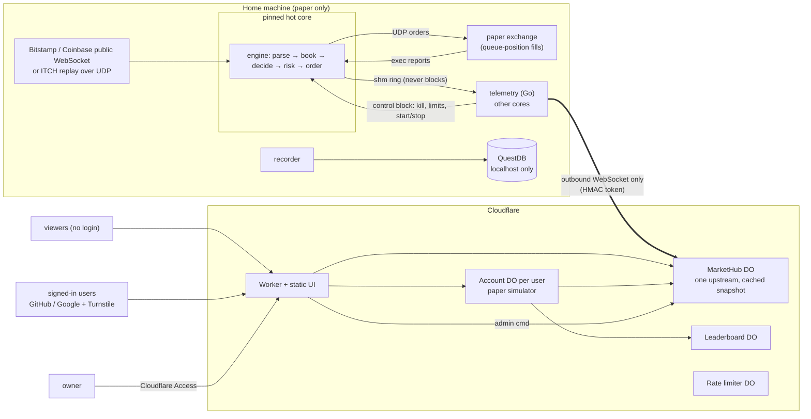

# Low-latency C++ trading engine on live market data, with paper trading and a public web UI

A C++20 engine built for the shortest possible **tick-to-trade**: the time from a market-data packet
arriving to the order leaving. It runs on live crypto data (Bitstamp and Coinbase public feeds) and on
replayed NASDAQ TotalView-ITCH 5.0 data, measures every stage with `rdtsc` and kernel `SO_TIMESTAMPING`,
and trades **only on paper** against a simulated exchange with queue-position fills.

> **Paper trading only.** Nothing in this repository can place a real order. There is no brokerage
> connection. The programs refuse to start if they see a live API key or a live trading endpoint, and a
> CI check fails if a live trading URL appears anywhere in the repo.

**Status (November 14, 2026):** the engine, tests, CI, paper simulator, telemetry and web UI all work
locally, and the first code-level optimizations are measured. The web UI is **not deployed yet**.
The clean latency runs on the tuned Ubuntu machine haven't been done, because that boot is offline.
Every number below was measured on a **laptop inside a VM** and is labelled that way.

## What's in it

| Part | Where | Notes |
|---|---|---|
| ITCH 5.0 feed handler | [engine/include/lle/itch.hpp](engine/include/lle/itch.hpp) | Parses in place: each field is read big-endian straight from the receive buffer, nothing is copied. MoldUDP64 framing. Length-checked per message type, and fuzzed |
| Order book | [ladder.hpp](engine/include/lle/ladder.hpp), [book.hpp](engine/include/lle/book.hpp), [order_map.hpp](engine/include/lle/order_map.hpp) | Flat price-level arrays (16-byte levels, 4 per cache line) with a two-level bitmap, so the next level is found with `tzcnt`/`lzcnt`. Preallocated order pool; open-addressing order map with backward-shift deletion; tables prefaulted and backed by huge pages |
| Matching engine | [matching.hpp](engine/include/lle/matching.hpp) | Price-time FIFO with intrusive lists, O(1) cancel, no allocation after startup |
| Strategy + risk | [strategy.hpp](engine/include/lle/strategy.hpp), [risk.hpp](engine/include/lle/risk.hpp) | Demo top-of-book imbalance taker (not expected to make money). The engine enforces its own risk limits: per-order size, position, notional, price band, orders/sec (token bucket on the TSC), orders/day, daily loss, and a kill switch |
| Order output | [order_codec.hpp](engine/include/lle/order_codec.hpp) | Pre-serialized 64-byte order templates: sending patches 4 fields and calls `send()` |
| Hot path | [pipeline.hpp](engine/include/lle/pipeline.hpp) | One pinned thread. No allocation, locks, logging, or system calls other than receive and send. Telemetry is written *after* the order leaves |
| Live crypto feeds | [ws.hpp](engine/include/lle/ws.hpp), [coinbase.hpp](engine/include/lle/coinbase.hpp), [bitstamp.hpp](engine/include/lle/bitstamp.hpp) | Own TLS WebSocket client. TCP bytes are read with `recvmsg` (to keep kernel RX timestamps) and decrypted through OpenSSL memory BIOs. JSON is scanned in place into fixed-point numbers, with no allocation and no doubles |
| Paper exchange | [paper_exchange.hpp](engine/include/lle/paper_exchange.hpp) | Fills against a mirror of the real book: added latency, queue position, trade-through and touch-cross fills, real fee schedules |
| Telemetry | [telemetry/](telemetry/) (Go) | Reads a lock-free shared-memory ring that the engine writes and never waits on. Aggregates, then streams a snapshot plus 10–20 Hz deltas. Writes admin commands to the engine's control block |
| Web | [web/worker](web/worker), [web/ui](web/ui) | Cloudflare Worker and Durable Objects: fan-out hub, per-user paper accounts, leaderboard, rate limiter. React UI with canvas charts |
| Tick store | [engine/src/recorder_main.cpp](engine/src/recorder_main.cpp) | Records live L2 updates and trades into QuestDB over its line protocol. Local and private only |

## Architecture



- **Viewers never reach the home machine.** Every page and every WebSocket is served by the Worker and
  the MarketHub Durable Object, which keeps the latest snapshot. With no viewers, the hub tells telemetry
  to pause deltas.
- **No inbound ports.** Telemetry dials *out* to the Worker. This deviates from the original plan of a
  Cloudflare Tunnel. The goal is the same, nothing listening at home, and Workers VPC (the private path
  used in `gpu-systems-lab`) doesn't document WebSocket upgrades. Admin commands come back down the same
  connection.
- **Public trading never touches the benchmark engine.** Each signed-in user's paper account is a separate
  Durable Object. It reads the public book from the hub and uses the same fill rules as the C++ simulator.

## Where it runs

| Piece | Host | How |
|---|---|---|
| Public site, edge cache, paper accounts, leaderboard | Cloudflare | Worker `paper-trading` on `workers.dev`, Durable Objects |
| Live engine (Bitstamp), paper exchange, telemetry uplink | iMac (Apple M1), native macOS | launchd agent ([deploy/macos](deploy/macos)), low-CPU mode, about 2% CPU per process |
| Coinbase recorder | iMac, native macOS | Same launchd agent; private only |
| Tick store (QuestDB) | iMac, Colima | [deploy/compose.imac.yml](deploy/compose.imac.yml); localhost only |
| Benchmarks: replay, OS and network ladder | GPU PC (i7-14700F), Ubuntu boot | Planned; the laptop numbers below are the "before" |
| Build, test, deploy | Laptop | Docker image [tools/dev.Dockerfile](tools/dev.Dockerfile); runs no services |

Why native macOS and not containers on the iMac: inside its Colima VM, outbound TCP connections to
Bitstamp and Cloudflare succeeded 0–1 times in 5 (November 14, 2026), even with host networking, while
the iMac itself connected 5 of 5. The engine builds for arm64 and macOS from the same source. On macOS
the Linux-only parts drop out: kernel RX timestamps, CPU pinning, busy polling and io_uring. That's why
the live latency on the site is labelled as a non-benchmark setup.

## Latency results

### Code-level (ladder step 1), in-process

Twenty million messages from NASDAQ's published ITCH sample (2019-12-30), restricted to the 8 most active
symbols. Measured on one pinned thread, median of 3 runs. *Tick-to-trade* here runs from the moment the
triggering message is handed to the engine to the moment `send()` returns, for messages that produced an
order.

**Machine:** Intel i3-1215U laptop, Windows 11, Docker Desktop (Hyper-V VM). This is a noisy host: the
same build differs by about 20% between sessions. That's why the v5 row and the `compiler:o3n` row below
don't match.

| Step | What changed | tick-to-trade p50 | p99 | p99.9 | book stage p50 | throughput |
|---|---|---:|---:|---:|---:|---:|
| v0 | Baseline: `std::map` book, allocate+decode each message, text order build | 762 ns | 5.33 µs | 59.90 µs | 48 ns | 2.08M msg/s |
| v1 | Flat price-level arrays + preallocated pool (Fibonacci-hashed order map) | 704 ns | 5.08 µs | 52.51 µs | **124 ns** | 2.46M msg/s |
| v2 | Zero-copy in-place ITCH parsing | 653 ns | 7.28 µs | 68.92 µs | 118 ns | 3.55M msg/s |
| v3 | Pre-serialized order templates | 400 ns | 1.64 µs | 31.18 µs | 118 ns | 3.44M msg/s |
| v4 | Identity hash for order refs | **310 ns** | **1.52 µs** | 27.90 µs | **31 ns** | 4.63M msg/s |
| v5 | Transparent huge pages, prefaulted tables | 316 ns | 1.61 µs | 32.41 µs | 31 ns | 4.32M msg/s |
| compiler | `-O2`, generic x86-64-v2, no LTO | 381 ns | 1.79 µs | 40.61 µs | 36 ns | 3.88M msg/s |
| compiler | `-O3 -march=native` | 377 ns | 1.72 µs | 41.02 µs | 35 ns | 4.10M msg/s |
| compiler | + LTO | 397 ns | 2.13 µs | 50.46 µs | 37 ns | 2.92M msg/s |
| compiler | + PGO (trained on synthetic data, measured on the real file) | 393 ns | 2.08 µs | 50.87 µs | 38 ns | 2.66M msg/s |

What the numbers say, including where they go against expectations:

- **Flat arrays alone made the book stage *slower*** (48 → 124 ns). With only 8 symbols, `std::map` and
  `unordered_map` stay small enough to fit in cache. My 4M-slot order table spread the live orders
  across 64 MB, so every lookup missed cache. Hashing order refs by their low bits (they're assigned in
  increasing order) keeps the live orders in a sliding window of the table, which fixed it: 31 ns.
- **Pre-serialized orders** removed the string formatting and cut p99 from about 5 µs to about 1.6 µs.
- **Huge pages, LTO and PGO:** no difference I can distinguish from noise on this machine. I'm reporting
  that rather than picking the best run. They get re-measured on the tuned box.
- **p99.9 sits in the tens of µs**, set by the VM and Windows host (interrupts, vCPU scheduling). Reducing
  that is what OS tuning (step 2) is for.

Reproduce with `tools/dbuild.sh` (see [Running it](#running-it)). Raw JSON is in
[results/laptop/](results/laptop/) and the table comes from
[tools/summarize_results.py](tools/summarize_results.py).

### Wire-level (kernel RX timestamp → order sent), UDP replay on loopback

| Receive mode | kernel RX → `send()` p50 | p99 | p99.9 | in-process p50 |
|---|---:|---:|---:|---:|
| blocking `recvmsg` | 1.62 ms | 17.04 ms | 29.10 ms | 6.77 µs |
| busy-spin non-blocking | 129 µs | 9.18 ms | 11.67 ms | 6.77 µs |
| `io_uring` | 86 µs | 10.22 ms | 12.45 ms | 8.41 µs |

**These laptop numbers don't measure the engine.** Even at 10k packets/s, the time from the kernel
stamping a packet to user space seeing it is tens of µs to ms inside the Hyper-V VM. A UDP `send()` on
loopback costs about 5 µs there. I'm including them as the "before" for steps 2 and 3, not as results.

### L2 book replacement (found on the iMac)

Bitstamp sends a top-100 snapshot about 10 times a second, and since the resync fix each one replaces the
book. `clear()` used to memset the whole 2^18-level window: about 4 MB of stores per side, per snapshot.
Walking the occupied-level bitmap instead cut the live engine's parse+apply p50 from **437 µs to 93 µs**,
and in-process tick-to-trade to 161 µs p50. This was measured on the iMac M1 in low-CPU mode over about
25 s of live data. The absolute values include waking from `poll()` with cold caches.

### Live feed (Bitstamp / Coinbase, laptop)

Reported separately from engine latency. On live crypto feeds the in-process time from a decrypted
message to the order leaving was about 45 µs at p50 over about 40 s. That covers JSON scanning plus about
10 book updates per message, inside the VM. The kernel-RX-stamp → send() time includes TLS decryption and
WebSocket framing.

**Network caveat:** a home connection is tens of milliseconds from the exchange, which dwarfs every
number on this page. That's why the code-level and wire-level numbers above use replay, and why live
latency is shown separately.

## Optimization ladder: status

| Step | What | Status |
|---|---|---|
| 1. Hot path in code | Variants v0–v5 and compiler flags above | **Measured** (laptop) |
| 2. OS tuning | `isolcpus`, `nohz_full`, `rcu_nocbs`, IRQ affinity to E-cores, P-core pinning, SMT sibling offline, performance governor, `mlockall`, huge pages | Scripts ready ([tuning/ubuntu-tune.sh](tuning/ubuntu-tune.sh), [tuning/run-ladder.sh](tuning/run-ladder.sh)). **Not measured**: the GPU PC's Ubuntu boot is offline |
| 3. Networking | busy polling (`SO_BUSY_POLL`), `io_uring` (implemented), AF_XDP if the NIC supports it | Busy-poll and io_uring paths are implemented; laptop numbers are VM-bound. NIC check ([tuning/check-nic.sh](tuning/check-nic.sh)) still to run on the GPU PC. AF_XDP not implemented |
| 4. Cloud server near the exchange | Optional | Not started. Needs approval and a cost estimate |

## Paper trading

- **The engine's own paper exchange** ([paper_exchange.hpp](engine/include/lle/paper_exchange.hpp)):
  - Orders take effect after a configurable latency.
  - Marketable orders walk the displayed book, minus liquidity the simulator already took.
  - Resting orders join the back of the queue and fill only after real executed volume at their price
    has used up the queue ahead of them, or when the market trades through or crosses them.
  - Fees: Nasdaq $0.0030/share to remove liquidity and a $0.0020 rebate to add it (approximate standard
    rates). Bitstamp 0.40% taker and 0.30% maker. Coinbase entry tier: sources disagree (0.60%/0.40% vs
    0.90%/0.50% after a September 2026 change), so the fees are flags.
  - Known optimism: our fills don't remove real liquidity from later real events, and hidden liquidity
    isn't modelled.
- **Public paper accounts** use the same rules, applied in each user's Durable Object. Each account
  starts with $100,000 of pretend money. The rules are a cash account with no shorting, at most 0.5 BTC
  and $25,000 per order, 20 open orders, and 200 orders a day, plus per-user rate limits. Turnstile guards
  sign-in, balance reset and account deletion.
- **Safety** ([safety.hpp](engine/include/lle/safety.hpp), [tools/check_no_live_urls.py](tools/check_no_live_urls.py)):
  - The only order-entry host the code accepts is Alpaca's paper API, hard-coded.
  - Live Alpaca keys (`AK…`) and any Coinbase or Bitstamp credentials in the environment make every
    binary exit with code 78.
  - CI fails if a live trading URL appears in any tracked file. The check caught one in this repo's own
    test file during development.
  - Alpaca support stops at that guard. No Alpaca data feed is implemented.

## Market data licensing

- **Coinbase:** its [Market Data Terms](https://www.coinbase.com/legal/market_data) (updated Aug 7, 2026)
  forbid displaying its data, or charts and analytics derived from it, to third parties. So Coinbase is
  used only privately: the engine, the recorder and private latency runs. Telemetry refuses to publish
  Coinbase data.
- **Bitstamp:** its [API page](https://www.bitstamp.net/api/) allows redistribution of its exchange data,
  with a signed agreement only for commercial use, so it powers the public pages, with attribution.
- **NASDAQ ITCH:** the sample files and any raw market data are never committed. `.gitignore` blocks
  them, and the synthetic generator covers tests and CI.

## Tests

- **Engine:** 61 GoogleTest cases covering parsing, the book against a `std::map` reference, the matching
  engine's quantity conservation, the paper exchange's queue model, WebSocket framing, Bitstamp resync,
  the shm seqlock and the paper-only guard. They pass under gcc-14 and clang-18 release builds, and under
  ASan+UBSan and TSan.
- **Deterministic replay:** the same input gives the same book digest and the same order stream, with or
  without UDP packetization, and both are checked against golden digests.
- **Fuzzing:** three libFuzzer targets (ITCH stream and MoldUDP64, Coinbase JSON, WebSocket frames). The
  first local runs did about 10M executions with no crashes. CI fuzzes each target for 60 s.
- **Other suites:** Go telemetry tests run under `-race`, and Worker tests use `node --test`. CI is in
  [.github/workflows/ci.yml](.github/workflows/ci.yml). It hasn't run on GitHub yet, because the repo
  isn't pushed.

Bugs the tests and live runs caught:

- A crossed Bitstamp book. Diffs that arrived before the seeding snapshot were dropped; now every snapshot
  re-seeds the book.
- Two consumers sharing one delta baseline in telemetry, which split the change stream between them.
- A `kernel_rx_to_user` measurement that used TSC-to-wall-clock conversion and drifted by milliseconds.

## Honest limits

- No FPGA, no colocation, no kernel-bypass NIC (Solarflare/ef_vi, DPDK). The fastest receive path here is
  a busy-polled socket or io_uring.
- Every benchmark number so far comes from a 2P+4E laptop inside a VM. Clean numbers need the tuned Ubuntu box.
- The always-on live demo runs on a shared iMac in low-CPU mode (it sleeps in `poll()` when idle). Its latency
  histogram shows that setup, not the engine's best case.
- The demo strategy is a toy and is **not expected to be profitable**. Its live paper P&L is negative,
  mostly from fees.
- ITCH order books cover a fixed $327 window per symbol at one-cent ticks. Orders outside it are counted
  but not laddered, and sub-penny stocks aren't supported.
- IEX historical captures (DEEP/TOPS pcap) aren't implemented yet; only NASDAQ ITCH is replayed.
- The JSON feed handlers rely on the venues' documented field order. Fuzzing shows they fail safe, but a
  format change would surface as malformed-message counts, not as wrong prices.

## Running it

Everything builds in Docker (Ubuntu 24.04, gcc-14, clang-18):

```bash
docker build -t lle-dev:latest - < tools/dev.Dockerfile
```

```bash
tools/dbuild.sh "cmake -S /src -B /build/rel -G Ninja -DCMAKE_CXX_COMPILER=g++-14 && ninja -C /build/rel && /build/rel/lle_tests"
```

```bash
tools/dbuild.sh "/build/rel/bench_pipeline --messages 5000000 --cpu 3"
```

```bash
DOCKER_EXTRA=--privileged tools/dbuild.sh "/src/tools/run_udp_bench.sh /build/rel spin demo 20000 500000"
```

Live Bitstamp engine, paper exchange and telemetry (local stream at `127.0.0.1:8090/snapshot`):

```bash
DOCKER_EXTRA=--privileged tools/dbuild.sh "/build/rel/paper_exchange --source bitstamp --orders 127.0.0.1:31012 & /build/rel/crypto_engine --venue bitstamp --exchange 127.0.0.1:31012 --control /dev/shm/lle-control & sleep 2; /src/telemetry/telemetry --ring /dev/shm/lle-telemetry-crypto --control /dev/shm/lle-control"
```

For the website, see [docs/DEPLOY.md](docs/DEPLOY.md).
